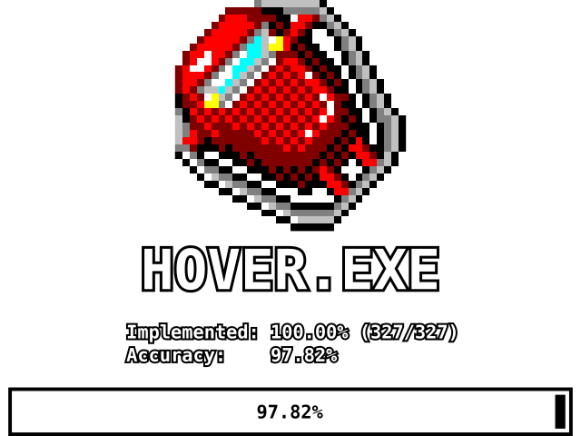

# FlyingDodgem

<p align="center">
  
</p>

Decompilation of 1995's HOVER!.

## Status

Screenshot progress




## Running

Both platforms below need the original game data; this repository ships none
(see Legal).

### Linux (AppImage)

Copy the data (MAZES SOUNDS DASHRES.DLL) from a legally obtained HOVER! install in:

   ```
   ~/.local/share/flyingdodgem/     game data (required)
   ```

### Android (APK)

Push the original game data onto the device:

   ```
   adb push /path/to/HOVER/DATA \
     /sdcard/Android/data/com.flyingdodgem.game/files/
   ```

   The app requests no storage permission and can only read its own
   app-specific directory, which is the path above. The data must be pushed
   after the app has been launched at least once (that creates the
   directory). Note that some Android 11+ devices refuse `adb` access to
   `Android/data` entirely; an in-app importer for those devices is planned,
   and is the only blocker for a permissionless data setup.
Start the app. Touch input is passed to the game as the pointer, so menus
   and the original controls are usable without a mouse; the app runs in
   sensor-landscape.

Debug-signed builds can only be replaced with `adb install -r` while the
signature still matches — reinstalling over a future release-signed build
requires uninstalling first.

## Build requirements

- SDL3
- 32-bit x86 compiler:
  - MSVC 4.0 compiler for matching build (4.2 works as fallback), or
  - a modern MinGW or MSVC toolchain

### Linux

`sudo pacman -S cmake glslang sdl3`
```sh
mkdir build && cd build
cmake .. -DCMAKE_BUILD_TYPE=Release
make
```

## Goals

- Exact same behavior as the original
- Matching binary

## Legal

FlyingDodgem is a fan-made reverse-engineering research project,
licensed under the [GNU GPL v3](LICENSE). It contains no original game
code or assets — a legally obtained copy of *HOVER!* is required to use it.

This project is not associated with, or endorsed by Microsoft Corp. All trademarks and copyrights related to
HOVER! are the property of their respective owners.
